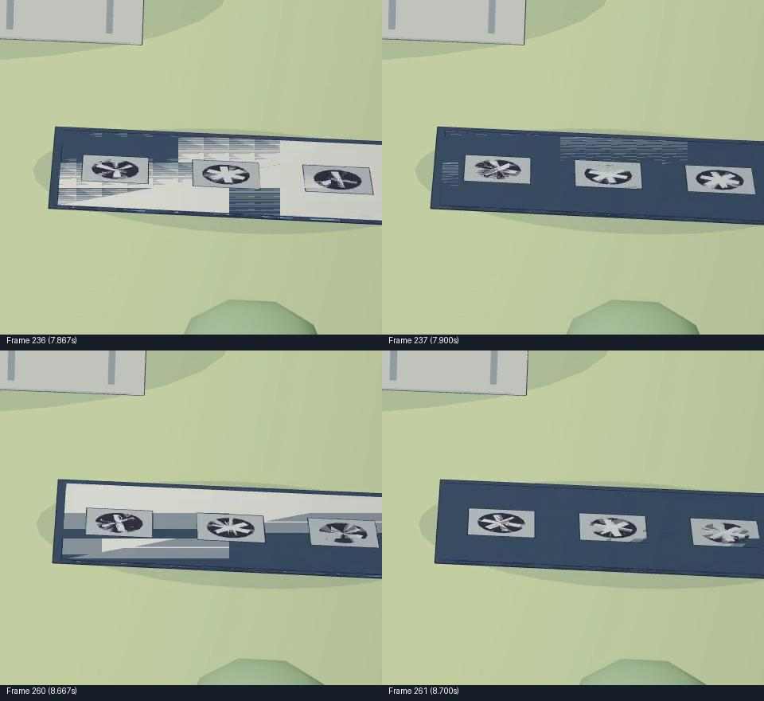
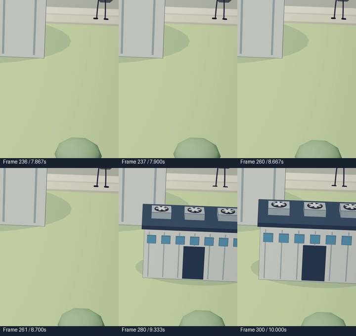

# Roof flicker and lighting continuity

**Historical verification:** the measurements and crop coordinates below describe the boxed-caption export at [commit 787fb8b](https://github.com/kaseyho/claude-animated-shorts/commit/787fb8b3147119a16c3bafc6115ff227f8ff5682). The current [punchier edit](../production/data-centres-natural/PUNCHY_EDIT.md) preserves the fix but changes camera views. Use that guide for current rendering and checks; reproduce the exact old crops from the historical checkout, not the new camera paths.

Diagnosis and verification, 5 November 2026. This accompanies the [boxed subtitle revision](shorts-boxed-caption-research.md). The targeted checks below cover the construction shot and representative scene frames; the final combined export was subsequently checked as recorded below and in the [subtitle production notes](../production/data-centres-natural/SUBTITLES.md).

## What was actually wrong

The apparent lighting glitch was localized **z-fighting on the waiting factories' roofs** in the second shot. Roof panels and fan housings flashed between pale stripes and dark surfaces as the camera moved. The old export shows clear examples at these adjacent global frame numbers, at 30 fps:

| Frames | Times | Observation |
|---|---|---|
| 236 → 237 | 7.867 → 7.900 s | Pale roof stripes disappear on the following frame. |
| 253 → 254 | 8.433 → 8.467 s | Roof panels change brightness within a single frame. |
| 260 → 261 | 8.667 → 8.700 s | Large pale triangles return to a dark roof. |



In the previous implementation, `Stage.buildout()` kept each waiting factory visible at `scale.y = .45 * .001`, while X and Z stayed at `.45`. This compressed the building, roof, fan housing and fan blades into nearly the same depth. Small camera changes then changed which surface won the depth test. This was a geometry/depth problem; the lights and exposure were not animating.

The previous whole-frame QA did not catch it. A small roof patch contributes little to the average difference across the full 180×320 frame. Its reported discontinuities were subtitle changes, but that did not rule out smaller visual defects. Inspect adjacent full-resolution crops as well as aggregate frame statistics.

## Changes

1. In [`world.ts`](../src/videos/data-centres/world.ts), `Stage.buildout()` hides a waiting factory until its reveal begins, then applies the same eased scale to X, Y and Z. Its silhouette grows while the relative spacing of roof and fan surfaces remains intact. It never waits as a full-width, nearly flat slab.
2. In [`DataCentres.tsx`](../src/videos/data-centres/DataCentres.tsx), the perspective camera near plane moves from `0.1` to `1`; the far plane stays at `150`. The current camera paths do not require objects within one world unit, so this improves useful depth precision. Three.js explains that depth precision is limited and unevenly distributed; near and far planes should fit the scene. [Three.js camera guidance](https://threejs.org/manual/pages/cameras.html)
3. `world.ts` and [`environment.ts`](../src/videos/data-centres/environment.ts) retain daylight through the noise scene. Previously it switched to blue night lighting at frame 1043 (34.767 s) and back at frame 1216 (40.533 s), although the narration did not establish a time change. That was an intentional earlier design choice, now corrected for continuity. The moon, warm night windows and lamp pool are removed from that scene; the sound-wave animation, residents and equipment remain.

The geometry fix is the primary correction. A tighter near plane is an additional precision improvement, not a substitute for separating surfaces. Recheck clipping whenever camera paths or foreground props change. A future close-up within one unit may require a smaller near plane and another depth review; do not reuse this value blindly or disable depth testing across the scene.



## Targeted verification completed

- `npm run typecheck` and `git diff --check` pass.
- The entire construction shot, global frames 207–405 inclusive, was rendered at 1440×2560. Twelve frames were visually reviewed: 236, 237, 252, 253, 254, 259, 260, 261, 264, 270, 280 and 300. The waiting roof no longer flashes; the later growth is proportional and clean.
- An independent review of the diagnostic clip confirmed the same result, including the later roof at frames 280 and 300.
- Twelve additional stills cover the opening, construction, server hall, utilities, noise-scene boundaries, meeting and closing: 30, 122, 260, 450, 790, 935, 1043, 1135, 1215, 1216, 1700 and 2122. No near-plane clipping was seen in these samples. The noise scene maintains daytime continuity.

The independent numerical check measured a right-hand roof region, X 125–179 and Y 190–224, after reducing each frame to 180×320. This region is outside the original captions. The table reports the absolute change in its mean luminance between adjacent frames, in percentage points of the 0–1 luminance range:

| Frame pair | Previous export | Fixed diagnostic clip |
|---|---:|---:|
| 236 → 237 | 8.714 | 0.00207 |
| 253 → 254 | 6.046 | 0.00125 |
| 260 → 261 | 7.099 | 0.00204 |

These measurements support the disappearance of the specific roof flashes. They are not a perceptual score or a claim that every possible artifact in the full film has been eliminated. The compared videos are the previous full export and the new construction-only diagnostic render, with matching global frames.

Local evidence is saved under `out/data-centres/lighting-audit/`, including `fixed-roof-metrics.json`. `lighting-buildout-fixed-review.jpg` and `lighting-fixed-review.jpg` contain the larger review boards. Output videos and QA intermediates remain excluded from Git; the compact before/after images above are included in the repository.

## Final combined export

The completed 1440×2560 boxed-caption video was checked again at the same three frame pairs. Their regional luminance jumps measured 0.00111, 0.00009 and 0.00092 percentage points respectively. This region is above the new caption boxes, so the check measures the repaired scene rather than a covering overlay. The final soundtrack is byte-identical to the preceding export's encoded AAC audio.

The full 2167-frame scan found no black frames, unexpected white frames or frozen runs. Its 80 raw image-difference flags all align with caption entrances/settling, exits or word-highlight starts. These aggregate results supplement the targeted roof evidence. Final-file metrics are in `out/data-centres/boxed-final-roof-verification.json`; the complete QA report is in `out/data-centres/boxed-qa/`.

## Reproduce the checks

Run from the repository root after installing the documented Node, Python and ffmpeg requirements:

```sh
npm ci
npm run typecheck
npx remotion render src/index.ts DataCentresNatural \
  out/data-centres/lighting-fixed-buildout.mp4 \
  --frames=207-405 --codec=h264 --crf=18 \
  --scale=1.3333333333333333 --concurrency=1 --gl=angle \
  --audio-codec=aac --props='{"subtitles":false}'
```

The diagnostic clip's local frame 0 is composition frame 207. Subtract 207 before selecting frames from that clip. Extract the repaired region at global frames 236, 237, 260, 261, 280 and 300:

```sh
ffmpeg -y -i out/data-centres/lighting-fixed-buildout.mp4 \
  -vf "select='eq(n,29)+eq(n,30)+eq(n,53)+eq(n,54)+eq(n,73)+eq(n,93)',crop=480:640:960:1280" \
  -fps_mode vfr out/data-centres/lighting-roof-%02d.png
```

Inspect the crops at native size. Waiting buildings should be absent, not flattened; later roof surfaces should stay clean as the building grows. For the archived pre-fix full export, global frames 236, 237, 260 and 261 with `crop=480:420:960:1460` reproduce the first evidence image.

Review the camera range and daylight boundaries with:

```sh
node production/data-centres/render-stills.mjs \
  30 122 260 450 790 935 1043 1135 1215 1216 1700 2122
```

Finally render the current combined edit and run the existing full-video checks:

```sh
npm run render:data-centres:natural
.venv/bin/python templates/scripts/short_qa.py \
  out/data-centres/why-neighbours-are-fighting-the-ai-boom-boxed-captions-2k.mp4 \
  out/data-centres/boxed-captions-qa \
  production/data-centres-natural/shots.json
```

Classify planned caption transitions and shot cuts separately from unexpected changes. Repeat the localized roof inspection on the final file as well: whole-frame averages alone previously missed this defect.
