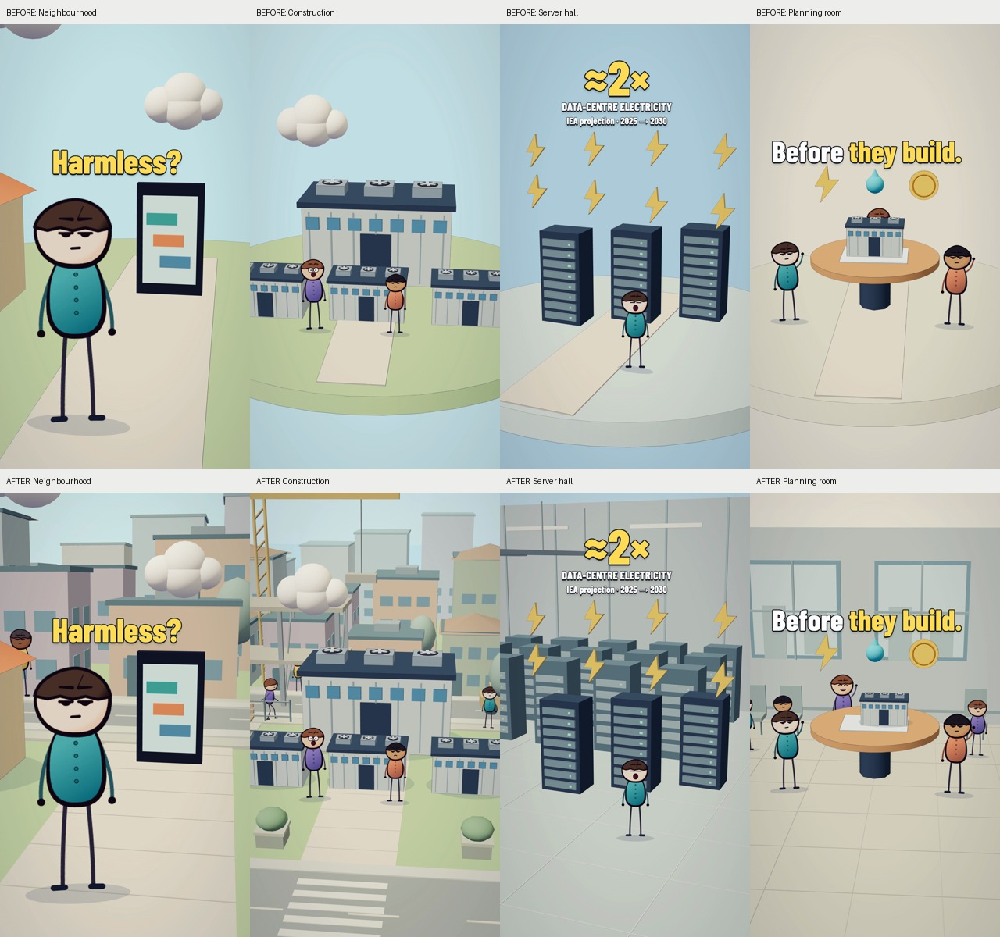

# Background design in animated Shorts

Research and production specification for the data-centre film, 5 November 2026.

The environments described below remain in the current export. The later [subtitle revision](../production/data-centres-natural/SUBTITLES.md) replaces the editorial text visible in this study's comparison frames with the full spoken script. The output filename and QA below refer to the background revision; see the repository README for the current render.

The film needs a world that continues beyond its main characters. Its circular platforms, single buildings and flat sky make neighbourhood scenes look like diagrams. The revision replaces those platforms with connected streets and courtyards, adds several layers of architecture and people, and gives the electricity and planning scenes their own interiors.

The references support **complete places, purposeful detail and clear visual hierarchy**. They also show when to simplify: an explanatory close-up can carry less surrounding detail than a street scene. More background activity should make the neighbourhood feel inhabited while leaving the current narration, characters and text easy to follow.

## Primary examples

Ten vertical Shorts were inspected in their official YouTube players on 5 November 2026. The Zack D. Films examples and two topical Kurzgesagt examples were selected from their **Latest** lists for relevant streets, interiors and infrastructure. The black-hole comparison, Jake Fellman examples and Alan Becker example were selected from **Popular** lists. Counts are the rounded numbers displayed on those lists at inspection time. This is a relevance-selected sample with substantial reach, not a worldwide ranking.

Observations below describe actual paused frames and changes between sampled times. They do not establish an exact animation curve, a full-video object count or a causal link between background density and views. Creator footage and characters are not incorporated into this project.

| Primary video | Displayed views | Sampled times | What the environment contributes |
|---|---:|---|---|
| Zack D. Films — [Mexican Batman Leaves Thieves Taped To Poles](https://www.youtube.com/shorts/XqlhWCNhatM) | 6.2M | 0.346, 17.066, 18.265 s | A continuous pavement and brick façade establish the opening. The later alley recedes between two building walls to a far building; fire escapes, cables, doors, windows, bins and wall lamps fill different depths. A subsequent close-up retains the wall, door, lamp and pavement. The setting survives the camera change. |
| Zack D. Films — [He Blew Up A House Over A Secret Will](https://www.youtube.com/shorts/EdUHm9FVRiU) | 6.4M | 1.560, 10.925, 20.611 s | The opening interior surrounds the person with a tiled floor, sideboard, vases, wall decoration, lamp, cabinetry and doorway. Later inserts concentrate on a tabletop document and a large explanatory object. The amount of environment changes with the shot's purpose. |
| Kurzgesagt — [Why Being Poor Is Expensive](https://www.youtube.com/shorts/VYhUa3WC4nU) | 3.8M | 6.704, 21.330, 40.960 s | At 21.330 s, a person holding money sits in front of overlapping rows of cars, dealership details and pale distant buildings. This makes the hierarchy particularly clear: subject, relevant midground inventory, simplified skyline. Other sampled moments use isolated explanation or a receding textured landscape. |
| Kurzgesagt — [Who Owns Your Drinking Water?](https://www.youtube.com/shorts/YHlqwkdVda8) | 2.3M | 5.893, 30.368, 51.207 s | The split landscape at 30.368 s layers foreground fencing/signs and a figure against a river, shrubs, varied trees and rock formations. Earlier and later samples isolate objects instead. Contextual geography and explanatory inserts serve different jobs. |
| Jake Fellman — [Minecraft RTX 54% SAVE THE SPIDER](https://www.youtube.com/shorts/o_kewJaE6S8) | 505M | 0, 5, 7.122, 10 s | Grass continues to the picture edges, with stone ledges and trees beyond. At 7.122 s several tree trunks overlap at different depths, while the spider remains visible in a clearing. A furnace and adjacent work prop later belong to that same environment. |
| Jake Fellman — [Minecraft RTX 24% ARROWHEAD LOOP](https://www.youtube.com/shorts/t_tor8HKOAQ) | 455M | 0.947, 5.198 s | A clear central grass patch holds the character and arrow action. Raised turf, stone ledges, surface texture and directional contact shadows establish the surrounding terrain and scale. The background is detailed but comparatively quiet. |
| Jake Fellman — [Among Us in HD Part 48 STOMP LOOP](https://www.youtube.com/shorts/vjrFp6SeyX0) | 735M | 5.649 s | A few characters occupy a complete interior with metal wall panels, repeating bolts, base trim, floor seams and reflections. A large figure and smaller figures create scale contrast. Surface structure supplies context without filling the room with unrelated props. |
| Alan Becker — [Sea Shanty — An Actual Short](https://www.youtube.com/shorts/SeyBYD0B2BY) | 59M | 0.945, 12.109, 17.723 s | Five differently coloured characters hold distinct props or instruments, with different hand/body poses between samples. Deck, railing, sea, rain, lantern and scattered objects establish the location. The upper sky stays simple. The ensemble has roles rather than one cloned idle pose. |
| Zack D. Films — [How To Trick Houses Into Giving More Candy](https://www.youtube.com/shorts/whNes1BxdLw) | 6.7M | 8.683, 25.648 s | A counterexample: the person/mechanism and later costumed figures sit against a simple blue gradient. The sampled explanation does not need a complete neighbourhood. |
| Kurzgesagt — [The Deadly Power of a Coin-Sized Black Hole](https://www.youtube.com/shorts/n2sn4kkkGQM) | 20M | 0.587, 9.042 s | Another counterexample: an opening bird/coin and later a glowing dark object use sparse fields and graphic marks. High reach does not require permanent environmental clutter. |

The street, forest and interior samples all give the main action somewhere to exist. That is the most useful correction to this film. Their specific stories, characters, destruction and environmental conditions are not models for our factual claims.

## Design principles for this revision

### Continue the ground beyond the subject

The existing circular rim explicitly ends the world a few metres behind the action. Replace it with ground that extends beyond the camera, connected pavements, a rear road and visible side streets. The main facility should belong to a neighbourhood with adjoining properties, rather than stand on a display base.

Ground treatment also provides scale. Kerbs, pavement joints, road markings, garden edges and modest contact shadows explain where people and objects stand. Do this before adding more decorative objects. The Fellman outdoor samples and Zack alley directly demonstrate the value of continuous terrain and architecture.

### Build several depths with different levels of detail

Use three useful bands in the exterior scenes:

1. The residents, phone, model or resource illustration occupy the main action area, with the strongest silhouettes and contrast.
2. Nearby homes, the facility, street furniture, parked vehicles and supporting residents give that action a local context.
3. More distant houses, low-rise blocks and trees extend the place; simpler shapes, quieter colours and atmospheric haze keep them subordinate.

These bands are an implementation framework, not a measured rule that every reference follows. The Kurzgesagt car-lot sample makes the subject-to-inventory-to-skyline structure especially readable. In this project, buildings must extend left of the world origin because the camera looks diagonally across the set; simply adding a row at `x=0` would put much of it offscreen.

### Make each prop explain the place

Use connected functions: a cooling yard has valves and service access, a construction precinct has scaffolding and materials, a neighbourhood has fences and lamps, and a civic room has chairs, windows and a noticeboard. Repeating building masses alone is not enough. Combine large structure, medium features and small readable details.

Pixar's sets-and-cameras explanation describes the environment as a means of conveying context and emotion, with camera composition chosen to support the story. Its discussion of procedural sets also supports controlled variation instead of hand-building every repeated detail. This is general production guidance, separate from the Shorts sample. [The Science Behind Pixar, developed with Pixar Animation Studios](https://sciencebehindpixar.org/pipeline/sets-and-cameras)

### Give supporting people a role

Keep the main speaker or explanatory figure easy to locate. Add smaller residents behind or beside that figure: a pair talking, a pedestrian on a pavement, a worker near service equipment, listeners at the gathering, and attendees in the planning room. Vary position, height, appearance, gesture and animation phase.

The Alan Becker sample supports an ensemble with distinct props and poses. Walking pedestrians, slow traffic and a construction crane are our adaptations to this particular film and the user's request for activity. Paused reference samples do not establish a universal amount or speed of background motion.

Walking figures need moving legs and a shadow that follows them. Background actors can use smaller texture canvases because their faces occupy fewer screen pixels. Motions must depend on the Remotion frame, so a repeated render produces the same scene.

### Vary the set with the narration

The electricity explanation belongs inside a cutaway server hall with rack aisles and cable infrastructure. The meeting belongs in a civic room. These changes make the visual rhythm less repetitive than ten versions of the same outdoor platform. Neighbourhood scenes retain recognisable houses and street elements so the final return feels connected to the opening.

The references' simplified inserts are a useful restraint. Keep the foreground electricity symbols countable and preserve the large forecast's source and years. Fill the room around the explanation without introducing competing symbols or another statistical claim.

### Preserve space for the current text

The researched text treatment remains part of the composition. Check its full visible intervals against rooflines, lamp posts, crane members and interior fixtures, including camera pullbacks. Outlined words can sit over a quiet wall or muted distant façade; a bright window grid or moving crane behind the small forecast qualification would undermine it.

YouTube's own visual guides show where interface elements can obscure overlays. Phone-scale readability and the live editor guides remain the publishing check; no fixed universal safe rectangle is assumed here. [YouTube visual guides](https://support.google.com/youtube/answer/16215842?hl=en)

## Scene plan

| Scene | Environment and supporting activity | Focal priority |
|---|---|---|
| Opening | Connected residential street, staggered houses, gardens, distant blocks, a rear pedestrian and modest traffic | Resident, phone, facility arrival and three opening text beats |
| Buildout | Construction precinct within the existing town; unfinished structure, fenced work area, materials, workers and a slow crane action | New facilities rising behind concerned residents |
| Electricity | Server hall with repeated rear racks, service aisles, wall panels and cable trays; a small maintenance figure | Three main racks, eight energy symbols, qualified approximate doubling |
| Grid | Homes and street connected to fenced transformer/service equipment; utility figure and vehicle | Pylons, lines, cost symbols and the question about payment |
| Water | Cooling/service yard with pipes, valves, maintenance access and surrounding industrial buildings | Existing tank, flow path and concerned resident |
| Noise | Night neighbourhood with lit windows, fences, lamps and additional residents | Home, facility and illustrative sound waves |
| Community | Town pavement or square, several building layers, street furniture and a broader varied gathering | Foreground residents and request for clearer answers |
| Benefits | Everyday town activity with shop details, shelter/benches, service access and people | Useful services and the qualified benefits narration |
| Consultation | Civic room with windows, chairs, tiled flooring and additional listeners; adjust the rear principal figure to clear the model | Planning table, three principal residents and the proposed safeguards |
| Finale | Return to the inhabited neighbourhood, including rear social groups, walking and quiet traffic | Foreground people and the closing question |

All scenery is fictional illustration. Do not add smoke, damaged homes, dried reservoirs or empty taps for atmosphere: those would imply harms the narration does not establish. Preserve the distinctions between a projection, local concerns and guaranteed outcomes from the [original evidence notes](../production/data-centres/SCRIPT.md).

## Implementation and review

`src/videos/data-centres/environment.ts` holds the reusable set dressing and scene-specific environments. `world.ts` retains the main narrative objects, continuous ground and character animation; `DataCentres.tsx` applies the scene fog. The natural narration, its timing and the occasional text cues remain the continuity reference.

Review the start, middle and end of all ten shots, with extra attention to the opening pullback, growing construction, the entire numerical caption and the closing push-in. Compare the same frames before and after at phone size. Check building placement, character/prop overlaps, moving shadows, visible population, relevant secondary movement and legibility. Then render the full 1440×2560 video and run the existing frame/audio QA.

## Applied result



The final implementation includes 26 background building masses across three depth bands in each outdoor set, with different heights, roofs, windows and distance treatment. Not every building is visible from every camera. Connected rear and foreground roads, crossings, paving seams, low planters and street furniture establish a continuous neighbourhood. Supporting residents walk or gesture on independent phases; the construction set includes a lifting crane load. Traffic follows a rear lane and can pass behind the main buildings.

The electricity set adds 15 rear rack units, cable trays, service aisles and an enclosed wall; the planning set adds a windowed room, tiled floor, chairs and observers. The rear principal resident and model were repositioned so the table no longer hides most of that character. Night scenes use cooler illumination, warm windows and street-light details.

Projection checks led to practical corrections: cooling valves, a technician, transformer equipment and shopfronts were brought into the visible portrait frame. Low foreground objects were positioned using the camera projection. A planter that intersected the benefits-scene bench was removed, and standing observers were separated from the chairs behind them. Main faces and the forecast qualification were retained as review priorities throughout.

## Verification and rebuild

The delivered file is `out/data-centres/why-neighbours-are-fighting-the-ai-boom-populated-world-2k.mp4`.

- TypeScript and whitespace checks passed. A separate code review found no blocking issues in deterministic motion, moving actor shadows, resource cleanup, local asset availability or entry registration.
- Forty stills covered the starts, midpoints and ends of all ten scenes plus important text/prop moments. Reviewers checked complementary groups of scenes; final-file samples confirmed the bench correction and the applied appearance. These are sampled visual checks, not a claim that every frame was manually watched.
- Automated QA inspected all 2,167 frames: 1440×2560, 30 fps, 72.235 seconds, AAC stereo at 48 kHz, −16.0 LUFS and peak −1.3 dBFS. No black frames, unplanned white frames or frozen spans of at least 12 frames were detected.
- Nine frame-difference spikes occurred at 558, 825, 1305, 1397, 1888–1891 and 1938. They coincide with the existing text entrances, exits or entrance scale accent, rather than a new background discontinuity.
- The QA tool's low-motion-frame fraction fell from 77% in the preceding text revision to 25% in this render. This is a pixel-difference diagnostic influenced by moving scenery and camera parallax, not a viewer-retention score.
- The narration, music, duration, spoken claims and text cue timing are unchanged. No synthetic exhaust, drought, damaged property or new factual labels were added.

From the repository root:

```sh
npm ci
npm run typecheck
npm run render:data-centres:natural
```

With the repository's Python environment configured, reproduce the raw frame/audio report with:

```sh
python templates/scripts/short_qa.py \
  out/data-centres/why-neighbours-are-fighting-the-ai-boom-populated-world-2k.mp4 \
  out/data-centres/populated-qa \
  production/data-centres-natural/shots.json
```

Source, research and the original-film comparison image are committed. Generated video and QA intermediates remain in the ignored `out/` directory. The reference videos are linked for study; none of their footage is bundled. Audience response to this revision has not been measured.
