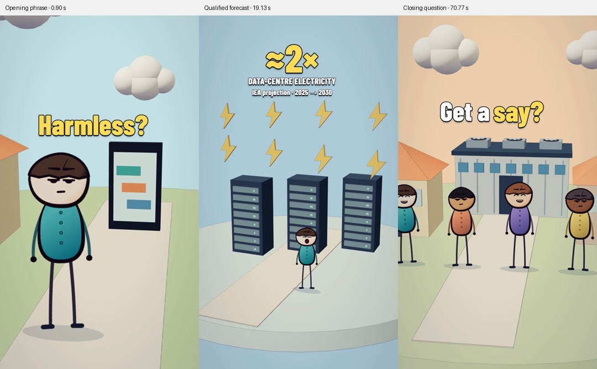

# Text design in high performing Shorts

Research and edit specification for the data-centre short, 5 November 2026.

Historical revision: the observations and edit plan below document the earlier selective text treatment. The user's subsequent request replaces those editorial hooks with full verbatim subtitles synchronized to the voice. The current implementation and output are documented in the [subtitle specification](../production/data-centres-natural/SUBTITLES.md) and repository README. References below to `hook-cues.ts` and `HookOverlays.tsx` describe the previous implementation; those files have been removed. The [background and environment revision](shorts-background-research.md) remains in the current video.

The strongest transferable pattern is **small units of text that arrive with a story beat and then leave**. In the sampled videos, words sit directly on the picture with a dark outline; colour singles out a meaningful word or amount. A permanent title card is not the common treatment. Some successful scenes, and one sampled animated explainer, carry no burned-in text at all.

For this film, replace the five boxed headlines with occasional short phrases timed to the existing natural narration. Let the opening develop from apparent harmlessness to a neighbour problem. Give the electricity forecast one larger numerical moment. Preserve text-free sections so the animation remains the story.

## Sample and method

The sample covers popular Shorts from Zack D. Films, MrBeast and Jenny Hoyos. These represent animated explanation, spectacle and dialogue, and compact challenge storytelling. Videos were selected from the creators' official Shorts **Popular** tabs, then inspected in the actual player at recorded times. Counts below are rounded figures displayed on 5 November 2026, not a ranking of every Short on YouTube.

The observations distinguish text burned into the video from optional YouTube closed captions. This matters particularly for *How Stitches Work*: switching CC off removed the small white-on-black captions. Approximate vertical positions refer to the video picture, not the surrounding browser window. They are visual estimates, not pixel measurements of source files. Sampled frames establish the treatment at those moments; they do not establish its use in every frame or every video on a channel.

Public views indicate reach, not the causal effect of typography. YouTube distinguishes starts from engaged views, and retention is a separate measure. No creator retention data was available for this study. [YouTube explanation of views and engaged views](https://blog.youtube/inside-youtube/engaged-views-youtube-explained/)

## Examples and observed text

| Creator and primary video | Displayed views | Sampled moments | What the text does |
|---|---:|---|---|
| Zack D. Films — [How Stitches Work](https://www.youtube.com/shorts/ttuKeS5k4Uo) | 255M | 0.195 s and 12.529 s, CC off | No burned-in editorial text at these moments. The wound and stitch action carry the explanation. The small caption strip seen with CC enabled was player-generated. |
| Zack D. Films — [How Splinters Get Unstuck](https://www.youtube.com/shorts/yGw0nhlUtkQ) | 216M | 0.190 s: “If you”; 5.744 s: “But sometimes”; 15.552 s: “under the skin” | One centered line, two or three words, heavy white sans serif with dark outline/shadow, around 78% down the picture. Text stays below the central action. No opaque panel. |
| Zack D. Films — [The Reason The McFlurry Spoon Looks Weird](https://www.youtube.com/shorts/rRAmNz6G3Tk) | 167M | 0.147 s: “Have you ever”; 1.208 s: “how odd”; about 5.590 s: “like a straw”; 11.148 s: “for these” | Short sentence-case phrases replace one another at a stable location around 76% down the picture. White letters and a dark edge provide contrast directly over the animation. |
| MrBeast — [Giving iPhones Instead Of Candy on Halloween](https://www.youtube.com/shorts/YlvcFJOE-OE) | 1.9B | 0 s, 5 s and 15 s: no caption; 10 s: “Happy Halloween!” | A short orange dialogue caption appears around 63% down the picture with a thick dark outline. It does not remain as a headline over subsequent action. |
| MrBeast — [Would You Fly To Paris For A Baguette?](https://www.youtube.com/shorts/se50viFJ0AQ) | 1.8B | 0.540 s: “give you”; 2.538 s: “a baguette?”; about 5.120 s: “$300”; 10.540 s: no caption | White connective text, yellow emphasis on the object, and a green amount. Short phrases sit around 63% down the picture. A number gets its own beat; the screen subsequently clears. |
| MrBeast — [$100,000,000 Car Doors](https://www.youtube.com/shorts/IQxea9UB1nQ) | 1.3B | 1.399 s: “$100,000”; 6.399 s: no caption | A green amount floats above the car, about 42% down the picture. Its placement responds to the object. Text disappears for the close-up door action. |
| Jenny Hoyos — [I Built a Secret Room with $0](https://www.youtube.com/shorts/bNrBRtX4mjc) | 184M | 0.161 s: “i'm building”; 1.682 s: “with $0”; 5.161 s: “your destroying” as displayed; 9.905 s: “to watch”; 15.110 s: no text | Two-word white or yellow phrases with heavy dark outlines replace each other near the picture's vertical centre. The visual subject, rather than a universal top-banner position, determines the caption location. |

These samples show two compatible approaches: phrase captions can support understanding, while selective labels and text-free shots let the reveal do the work. They do **not** establish that every popular Short needs continuous subtitles, all-caps lettering, bouncing words, or a fixed number of cuts per second.

A closer timing check in *Splinters* found the opening phrase still visible at 0.387 s and its replacement visible at 0.649 s. The replacement therefore occurs within that 262 ms observation window; this is not an exact transition time or a measurement of the entrance animation. Further sampled phrases appear at 1.566 s and 2.876 s. Four text states within the opening 2.876 seconds are a concrete contrast with our previous multi-second billboard holds.

## What transfers to this film

### Start the tension immediately

The first image and first text need to be legible while a viewer is deciding whether to stay. Jenny Hoyos's conversation with YouTube's Shorts product lead stresses a first-second hook and a compact setup, intrigue and payoff. It is creator guidance, not a measured universal one-second cutoff. [YouTube creator interview, 28 January 2025](https://blog.youtube/creator-and-artist-stories/youtube-shorts-deep-dive/)

The opening narration already contains that structure: the cloud sounds harmless, a facility arrives next door, and the issue becomes personal. Three short text states can expose that progression. A seven-word question held over the whole opening competes with it and reveals less of the change.

### Keep one reading task on screen

The sampled caption phrases contain one to three words. They form complete readable chunks; a viewer does not have to finish a paragraph while also inspecting the scene. Use one to four prominent words per state in this edit. That range is an editorial choice informed by the sample, not a platform requirement.

Replace one phrase with the next. Avoid accumulating a whole sentence word by word or keeping an obsolete hook above a new spoken point. Maintain a stable location inside each burst. Reposition between scenes only when the action needs the space.

### Make emphasis mean something

In the baguette example, the object and money are distinguished through colour. In the car example, the amount sits with the object being priced. For our film, warm yellow identifies a consequence, key word or the forecast magnitude; white carries the connecting words. Keep the palette consistent instead of assigning a new colour to every word.

Use the electricity multiplier as an exceptional large element. Its support text must identify **data-centre electricity**, the **IEA projection**, and **2025 to 2030**. Approximately double is a forecast of total data-centre consumption, not a claim that a resident's bill will double. The IEA projects 485 TWh in 2025 rising to about 950 TWh in 2030. [IEA executive summary](https://www.iea.org/reports/key-questions-on-energy-and-ai/executive-summary)

### Put the words near the story without covering it

The examples use different heights, from roughly 42% to 78%, depending on faces and objects. Copying a lower-third position mechanically would cover this film's characters and phone. Our action is generally in the lower half, with substantial sky above it. Place most text in the clear upper-middle space, closer to the action than the previous top banner. Let the opening's short question sit between the cloud and the resident.

YouTube's own editor shows visual guides for interface elements and warns when an overlay approaches an unsafe edge. There is no single fixed margin prescribed here for every device and player state. Keep our important text inside a conservative working rectangle and inspect at phone size; check the live Shorts editor guides before eventual upload. [YouTube visual guides and timed text](https://support.google.com/youtube/answer/16215842?hl=en)

### Use motion for the arrival and then let the words settle

The frame observations establish replacement phrases and contrasting letters, not an exact animation curve. This edit uses a restrained, short scale accent on arrival or on the emphasized word, followed by a steady hold. That is our adaptation. A 4–6-frame accent at 30 fps is long enough to register without making the reader chase a wobbling line. No constant rotation, shake or looping bounce.

The narration remains at its existing native speed and pitch. Text follows the measured speech, not an arbitrary timer that requires the voice to accelerate. Short phrases may remain a little beyond their spoken word so they can be read. The opening can preview a phrase before its emphasis lands; the numerical qualifier remains visible for the entire numerical beat.

## Timed edit plan

Times refer to the 72.23-second `DataCentresNatural` composition and the saved native word timings. Final frame-rounded boundaries live in `src/videos/data-centres/hook-cues.ts`.

| Story beat | Approximate time | Text and purpose |
|---|---|---|
| Apparent harmlessness | Opening second | `Harmless?` appears immediately and accents the spoken word. A compact curiosity gap that the next shot resolves. |
| Physical proximity | 3.81–4.98 s | `Next door.` lands with the location phrase. |
| Personal consequence | 5.67–6.90 s | `It's personal.` completes the opening contrast. |
| Demand forecast | 18.62–22.30 s | A large `≈2×` with `DATA-CENTRE ELECTRICITY` and `IEA projection · 2025 → 2030`. The magnitude lands on “double.” |
| Who bears the cost | 25.19–27.50 s | `Who's paying?` with the cost word emphasized. A question, not an assertion that neighbours will pay. |
| Local disturbance | 35.88–37.50 s | `The noise.` briefly reinforces the existing noise scene. |
| Community demand | 43.50–46.57 s | `Clearer answers.` holds above the residents and accents “answers.” |
| Timing of consultation | 62.94–64.60 s | `Before they build.` emphasizes the proposed timing, without claiming a legal entitlement. |
| Closing question | 70.17–72.23 s | `Get a say?` leaves the viewer with the narration's question. |

The aim is occasional bursts, with most of the runtime free of editorial text. These are not full accessibility captions. A separate caption track would be needed for complete sound-off comprehension.

## Typography and implementation

Use a bundled Barlow Condensed ExtraBold face for stable cross-machine output. It is our selected typeface, not a claim about the creators' original fonts. Keep the main words large, with dark outlines and a compact shadow; remove the navy rectangle, border and card padding. Typical text size is around 116–144 design pixels on a 1080×1920 canvas, adjusted for wording. The statistic is larger; its qualifier remains readable at a 360-pixel-wide preview.

Load the font before rendering so the output never captures a fallback face. Bundle its SIL Open Font License with the asset. [Google Fonts Barlow Condensed source and license](https://github.com/google/fonts/tree/main/ofl/barlowcondensed), [Remotion local font loading](https://www.remotion.dev/docs/fonts-api/load-font)

Keep cue content and word anchors separate from the rendering component. Retiming the native narration should move word-anchored cues with it. A missing word anchor should fail clearly rather than silently attaching a hook to the wrong scene. The existing `hooks: false` input must continue to render without editorial overlays.

## Review and evaluation

Before delivery, review the opening, every text burst, the multiplier's full qualification, and the last frame at phone scale. Inspect entry, emphasized-word and exit frames, not just a flattering still. Check that faces, the phone, rack symbols, and the planning table remain readable. Render the full 1440×2560 video and run the existing video/audio QA.

After a future publication, compare audience retention and stayed-to-watch behaviour with comparable uploads. Inspect losses around text arrivals and long holds. A retention spike can mean either interest or confusion requiring a rewatch; it is not automatically evidence that an effect worked. This edit has not been audience-tested. [YouTube retention guidance](https://support.google.com/youtube/answer/9314415?hl=en)

The research supports a more deliberate visual treatment. It does not promise virality or establish that typography caused the reference videos' view counts.

## Applied result and verification

The implementation uses nine text states across seven story beats, visible for 18.7 seconds in total. Approximately 74% of the 72.23-second timeline remains free of editorial text. The largest state is the qualified electricity forecast; the other phrases use sentence case and selective yellow emphasis. The two later opening phrases move above the rising roof, while the forecast stays above the lightning symbols.

The final export is `out/data-centres/why-neighbours-are-fighting-the-ai-boom-researched-text-2k.mp4`. It was rendered and inspected on 5 November 2026:

- TypeScript and diff whitespace checks passed. All nine cues resolve against the saved narration, have valid start/hit/end ordering, and do not overlap.
- Font loading succeeded from the bundled asset. A separate render with `hooks: false` confirmed that the overlay can be disabled.
- Entry, emphasis and exit samples were inspected for all nine states. The final forecast and closing states were checked through their last visible frames. The revised proximity phrase was rechecked at frames 114 and 148 as the building rises.
- Full-file QA checked all 2,167 frames: 1440×2560, 30 fps, AAC stereo at 48 kHz, measured duration 72.235 seconds, loudness −16.0 LUFS and peak −1.3 dBFS. No black frames, unplanned white frames or frozen spans of at least 12 frames were detected.
- The generic frame-difference detector flagged 12 abrupt changes at frames 56, 149, 558, 825, 1125, 1305, 1397, 1888–1891 and 1938. Each matches a configured text entrance, exit or entrance scale accent and was reviewed as intentional; the report is not described as having zero flags.

To reproduce the export, run `npm ci`, `npm run typecheck`, and `npm run render:data-centres:natural`. Run `python templates/scripts/short_qa.py out/data-centres/why-neighbours-are-fighting-the-ai-boom-researched-text-2k.mp4 out/data-centres/researched-final-qa production/data-centres-natural/shots.json` in the configured Python environment for the raw QA report and frame sheets. Generated videos and QA intermediates remain outside Git; the source, font, research and preview above are included.
