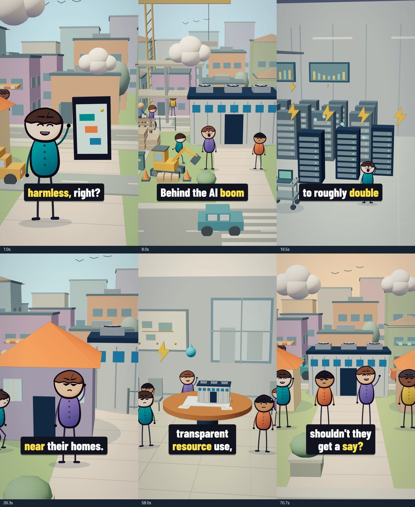

# Punchier picture and sound revision

5 November 2026. This pass applies the [Shorts playbook](../../docs/shorts-playbook.md) to the existing data-centre film: a clearer reveal, more changes in viewpoint, expressive reactions and visibly active environments. It retains the 161-word natural narration, measured word timings, ten scene boundaries and 50 verbatim subtitle cues. The separate [script blueprint](RETENTION_BLUEPRINT.md) remains a proposal; this revision does not claim that script rewrite was performed.

## What changed on screen

The previous edit mostly held a wide view of each scene while small objects floated. The revised picture uses **29 camera beats with 19 internal cuts**, in addition to the nine existing scene transitions. Each closer view introduces an object, mechanism, reaction or consequence. Short moves within each view supply parallax. These counts describe this edit, not a target for every Short.

| Scene | New picture progression | Supporting activity |
|---|---|---|
| Opening | Phone and resident close-up → facility reveal at “Until” → resident reaction at “personal”; the building reaches full size near “moves next door.” | Opposing traffic, delivery van, cyclist, passers-by, storefront detail and birds |
| Construction | Wide site → closer building reveal → resources/reactions | Moving excavator arm and bucket, lifting crane load, workers with helmets, service van, pallets and cones |
| Electricity | Server detail → wider demand display → second row appears on “double” | Additional rack lights, technicians, trolley and abstract monitor activity |
| Grid/cost | Shared grid → visible power connection → resident and cost symbols | Traffic, substation service details and technician |
| Water | Context → cooling mechanism → resident concern | Turning valve details, flow pulses and workers |
| Noise | Neighbourhood → equipment → resident reaction | Continuous daylight, street activity and a localized illustrative equipment hum |
| Community | Group context → closer demands/reactions | Independently phased gestures and surrounding residents |
| Benefits | Facility context → useful phone/service → investment symbols | Shopfronts, tables, local activity and passing traffic |
| Planning | Shared model → resource/noise/cost symbols appear with their phrases → people participate | Civic-room presentation graphics, documents and supporting attendees |
| Ending | Neighbourhood → people → final question | Street continuity and final gestures, with room for the question to register |

Main character expressions now change at the story turns. Story props use deeper teal/navy and brighter coral/gold; natural-variant exposure is slightly lower at `0.94`. Caption boxes settle from 91% to 102.5% at frame 3, then 100% at frame 6. Words, phrase breaks, location and current-word highlighting stay synchronized to the existing voice.



The additions are original procedural illustrations. Buildings do not explode, water supplies do not empty, and no fictional damage is presented as evidence. The electricity increase remains an attributed projection, and the planning symbols illustrate proposed safeguards rather than an actual approval.

## Motion and lighting constraints

- `world.ts` defines normalized camera beats and exports `CAMERA_CUTS`. The native composition maps these across its measured scene durations; voice playback is never accelerated.
- All motion derives from frame time or normalized scene progress. Rendering frames out of order must produce the same result.
- Vehicles, walkers, construction machinery and indoor activity occupy different depths and phases. Main faces, proof objects and captions keep priority.
- Buildings remain hidden until their reveal and grow uniformly in all dimensions. The earlier roof depth-fighting repair and camera near plane of 1 remain in place.
- Noise-scene lighting stays in the same daytime setting. Changes of viewpoint must not be mistaken for a time-of-day change.

## Sound design

`punchy_audio.py` reads the native voice and original music masters, adds locally synthesized effects and a light rhythmic layer, and writes `public/data-centres-natural/punchy-mix.mp3`. It uses selected measured phrases for reveals, water accents, cost/service clicks and the planning sequence. Backing levels dip during the premise, equipment explanation and closing question so that the voice remains clear.

The narration is the same take, with no resynthesis, pitch alteration or time compression. Final mix mastering affects its level along with the backing. The [audio report](punchy-audio-report.json) records source hashes, cue times, decoded sample count, loudness and peak measurements. Effects illustrate action; they are not field recordings of a real facility.

## Rebuild

A fresh clone already includes the playback MP3 and needs no speech-service account to render:

```sh
npm ci
npm run typecheck
npm run subtitles:check
npm run render:data-centres:natural
```

Output: `out/data-centres/why-neighbours-are-fighting-the-ai-boom-punchy-2k.mp4`, using the existing `DataCentresNatural` composition at 1440×2560 and 30 fps.

To rebuild the backing mix from local masters:

```sh
.venv/bin/python production/data-centres-natural/punchy_audio.py
```

If the local masters are absent, first follow the [base narration rebuild](README.md#rebuild). That step requires the listed Python dependencies and network speech synthesis. A newly synthesized take can change timing: regenerate the timeline and captions and synchronize `natural-story.ts` before producing the final video. The offline sound pass validates the expected native rate, pitch, stem length and unique word phrases.

Review stills without overwriting earlier comparison frames:

```sh
STILLS_DIR=out/data-centres/punchy-review \
node production/data-centres/render-stills.mjs \
  0 30 72 122 185 240 310 450 585 790 880 995 1135 1320 1505 1600 1740 1850 2122
```

`STILLS_SCALE` optionally changes the default half-size output. Review moving output around the new camera cuts and growing roofs; isolated stills cannot establish clean motion. Use the [lighting guide](../../docs/data-centres-lighting-fix.md) for the failure mode, but select roof regions from the revised camera views instead of reusing the old crop coordinates blindly.

Build the expected camera/caption boundaries and scan the complete export:

```sh
node production/data-centres-natural/build_review_metadata.mjs
.venv/bin/python templates/scripts/short_qa.py \
  out/data-centres/why-neighbours-are-fighting-the-ai-boom-punchy-2k.mp4 \
  out/data-centres/punchy-qa \
  out/data-centres/punchy-qa-meta.json
```

The metadata helper reads the actual `CAMERA_TRACKS` time expressions through TypeScript's parser and combines them with native scene boundaries and generated subtitle transitions. It does not execute the scene. This separates intentional edits from unexplained image changes; it is not a substitute for inspecting local surfaces or composition.

## Verification record

The source passes TypeScript, subtitle freshness/transcript coverage and whitespace checks. The new MP3 decodes to exactly 3,467,200 stereo samples at 48 kHz (72.233333 seconds), measures −16.07 LUFS and −1.48 dBTP, and rebuilds byte-identically.

- **Final export:** H.264, 1440×2560, 30 fps, 2,167 frames, 72.235 seconds, 44,804,758 bytes; stereo AAC at 48 kHz.
- **Final audio:** −16.0 LUFS, 3.5 LU loudness range, −1.5 dBFS reported peak; no silence spans reported by the configured detector.
- **Complete numerical scan:** every frame inspected at 180×320. No black frames, unplanned white frames, frozen runs of at least 12 frames, or unexplained frame-difference spikes after accounting for the explicit camera cuts and caption transitions.
- **Visual checks:** 23 final-export frames cover all ten scenes, the opening reveal, construction growth, close-ups, subtitle clearance, the equipment-to-resident sequence and the ending. Adjacent full-resolution roof crops at frames 260–261 show stable surfaces. An independent reviewer confirmed those sampled findings.
- **Problems caught and fixed before export:** new activity initially hidden behind buildings; construction machinery off-screen; an indoor sky strip; unreadable bird shapes; an unsafe walker path; and worker helmets positioned above their drawn heads. Character texture resolution was increased for cleaner close-ups.

The review used sampled frames, consecutive roof crops and numerical audio/motion checks; it was not a continuous audiovisual audition. Whole-frame checks can miss small local defects, which is why the roof crops and camera-specific review remain necessary. Local evidence lives in `out/data-centres/punchy-final-review/`, `punchy-review-v2/` and `punchy-qa/`; the compact image above is included in Git.

These are technical and editorial checks. This film has not been audience-tested; no improvement in retention or reach is claimed.
