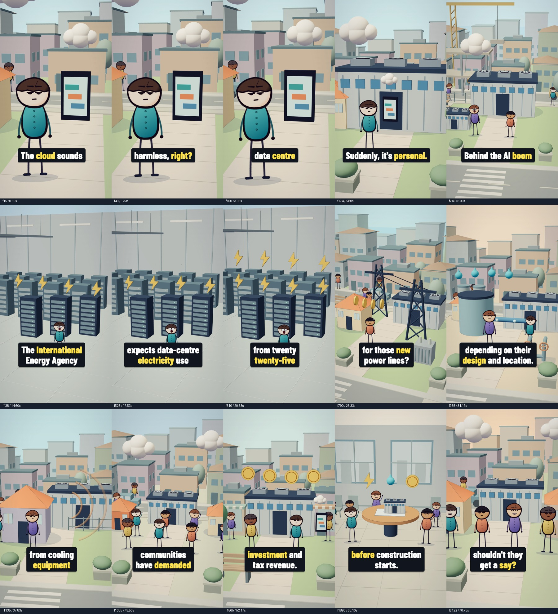

# Boxed script subtitles

Updated 5 November 2026. The full spoken script remains synchronized to the voice; the latest treatment adds larger type, compact dark boxes and speech-timed yellow emphasis. See the [fresh creator study](../../docs/shorts-boxed-caption-research.md) for references and the [lighting repair guide](../../docs/data-centres-lighting-fix.md) for the accompanying roof-flicker fix. Narration, pitch, playback speed, music and scene timings remain unchanged.

## Wording and timing

- `timeline.json` supplies the exact script, including punctuation and contractions. All 161 words appear once, in order, across 50 cues.
- `words.json` supplies native narration timestamps. These already include each scene's voice offset; do not add it again.
- `subtitle-phrases.json` controls phrase and line breaks. Joining each scene's phrases must reproduce its script exactly. Most cues contain two to four words; names and fast passages use longer two-line phrases where needed for readability.
- Each cue starts at its first word, rounded to the nearest 30 fps frame. It ends up to 180 ms after its last word, capped at the next spoken phrase or scene boundary. Cues cannot overlap.
- `subtitles.json` contains cue boundaries and all 161 frame-rounded `wordStarts`. The currently spoken word turns yellow at its onset; its highlight holds until the next word starts or the cue ends. Colour changes do not move the letters.
- `subtitles.srt` uses the same wording and cue times. SRT provides plain subtitle text, without the baked-in box, colour or entrance animation. These subtitles transcribe speech; they do not label instrumental music or effects.

## Appearance

At the 1080×1920 composition size, use bundled Barlow Condensed ExtraBold at 92 px with line height 1.08. White text sits on an opaque `#11151e` box; the spoken word is `#ffe14a`. The box has 30 px horizontal padding, 17 px top padding, 20 px bottom padding, 16 px corners and a small downward shadow.

The reading area has 70 px left and 150 px right margins and ends 350 px above the bottom. Each box fits its text rather than spanning the entire area. The box is fully visible from the cue's first frame and scales from 96% to 100% over four frames, then holds steady. It never changes font size or word spacing during highlighting. The local font loads before rendering.

Subtitles are enabled by default only for `DataCentresNatural`; the other narrations have different scripts and timings. `{ "subtitles": false }` disables them. The earlier `{ "hooks": false }` alias remains supported, and an explicit `subtitles` value takes precedence.



## Editing and rendering steps

1. Edit the phrase and line breaks in `subtitle-phrases.json`. Preserve every word and its punctuation from `timeline.json`.
2. Run the commands below to regenerate both subtitle formats, check consistency and render the full video.
3. Review the opening, longest line, agency name, date range, noise scene and closing question at phone size. Check the four-frame entrance and word highlights in motion.
4. Follow the localized roof checks in the lighting guide as well as full-frame QA. Caption changes can legitimately trigger image-difference flags, and whole-frame averages can miss small surface flicker.

```sh
npm run subtitles:data-centres
npm run subtitles:check
npm run typecheck
npm run render:data-centres:natural
.venv/bin/python templates/scripts/short_qa.py \
  out/data-centres/why-neighbours-are-fighting-the-ai-boom-boxed-captions-2k.mp4 \
  out/data-centres/boxed-qa \
  production/data-centres-natural/shots.json
```

The generator verifies exact transcript coverage, ordered word timestamps, scene containment and non-overlapping cues. The render script runs the freshness check automatically. If narration changes, rebuild its word timings and scene timeline, update phrase groups to match the new script, and regenerate subtitles. The audio builder also calls the subtitle generator. Keep the generated JSON and SRT together in commits.

## Completed verification

- TypeScript, generated-file freshness and exact transcript checks pass. All 161 words appear once across 50 ordered cues; JSON and SRT agree. Every highlight start matches its native word time rounded to a frame, with a maximum rounding error of 16.33 ms. The shortest cue lasts 0.6 seconds; two shorter candidate fragments were merged before rendering.
- Every line fits the 860 px reading area. The widest box, including padding, measures approximately 849 px. Fifteen representative frames were visually reviewed, covering all ten shots, long lines and the new word highlights.
- The final export is 1440×2560 at 30 fps, 2167 frames, 72.235 seconds, with AAC stereo at 48 kHz. All frames were checked at 180×320 for black frames, unexpected white frames and frozen runs; none were found.
- The raw motion detector flags 80 changes outside shot cuts. All coincide with caption entrances and their four-frame scale settling, exits, or exact word-highlight starts. No unexplained flags remain in that detector. This is supplemented by the targeted geometry checks below, not treated as proof that every localized artifact is absent.
- The final file's affected roof region was checked at frames 236–237, 253–254 and 260–261. The previous 6.05–8.71 percentage-point luminance jumps are now below 0.0012 points. The independent construction-only render also passed visual inspection of the waiting and growing roofs.
- Export loudness is -16.0 LUFS, with 3.5 LU loudness range. The encoded AAC soundtrack has the same SHA-256 hash as the preceding subtitled export.

Local artifacts are in `out/data-centres/boxed-qa/`, including the raw report, per-frame metrics and `subtitle-transition-review.json`. `out/data-centres/boxed-final-roof-verification.json` records the final-file regional check and audio identity. Videos and local QA intermediates remain excluded from Git; the current render command and compact review images are included.
