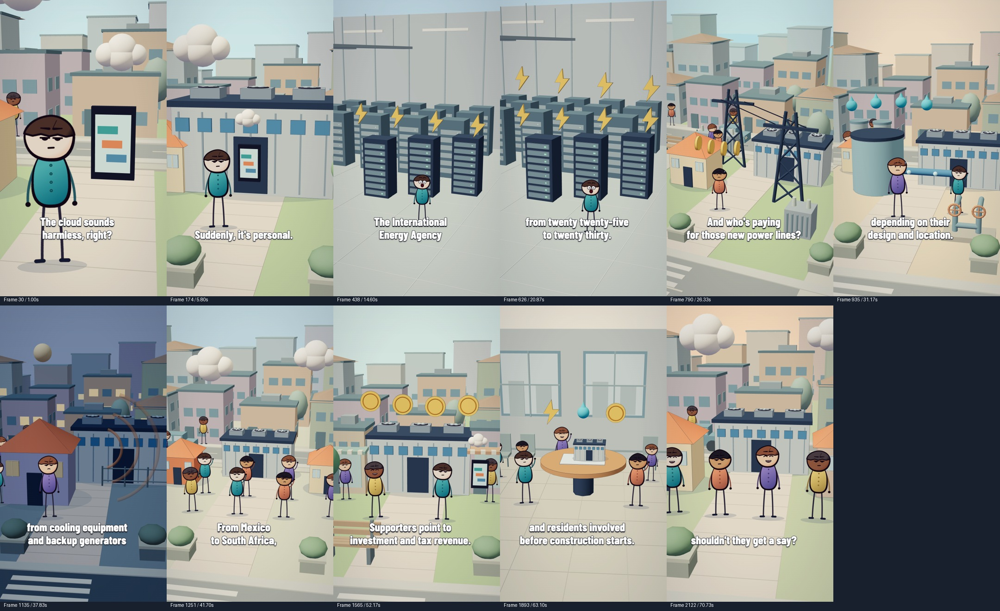

# Full script subtitles

Updated 5 November 2026. The latest request is to show the spoken script in time with the voice. This supersedes the earlier clickbait overlay treatment. The populated environments, narration, pitch, speed, music and scene timing remain unchanged.

## Wording and timing

- `timeline.json` supplies the exact script, including punctuation and contractions. All 161 words appear once, in order, across 33 cues.
- `words.json` supplies native narration timestamps. These already include each scene's voice offset; do not add that offset again.
- `subtitle-phrases.json` controls only phrase and line breaks. Joining each scene's phrases must reproduce its script exactly. Names and related number phrases stay together.
- Each cue starts at its first word, rounded to the nearest 30 fps frame (at most 16.7 ms rounding error). It ends up to 180 ms after its last word, capped at the next spoken phrase or scene boundary. Cues cannot overlap.
- `subtitles.json` drives the Remotion overlay. `subtitles.srt` uses the same frame-rounded boundaries and wording for a portable subtitle track. These transcribe speech; they do not label the instrumental music or effects.

## Appearance

Use steady white Barlow Condensed ExtraBold text with a dark outline, no headlines, keyword colour changes or entrance animation. Each cue contains one or two lines. At the 1080×1920 composition size, the type is 74 px; the text area has 80 px left and 160 px right margins and ends 360 px above the bottom. The extra right margin leaves room for common player controls. The local font loads before rendering.

Subtitles are enabled by default only for `DataCentresNatural`; the other narrations have different scripts and timings. `{ "subtitles": false }` disables them. The earlier `{ "hooks": false }` alias remains supported, and an explicit `subtitles` value takes precedence.



## Rebuild and verify

```sh
npm run subtitles:data-centres
npm run subtitles:check
npm run typecheck
npm run render:data-centres:natural
```

The generator verifies exact transcript coverage, ordered word timestamps, scene containment and non-overlapping cues. The render script runs the freshness check automatically. If the narration changes, rebuild its word timings and scene timeline, update the phrase groups to match the exact new script, and regenerate subtitles before rendering. The audio builder also calls the subtitle generator.

Review frames with the longest lines, the agency name, the date range and the opening and closing sentences. Check every cue transition against the rendered video and distinguish intentional text changes from rendering discontinuities. The final output is `out/data-centres/why-neighbours-are-fighting-the-ai-boom-subtitled-2k.mp4`.

## Completed verification

- TypeScript, generated-file freshness and exact transcript checks pass. All 161 words appear once across 33 ordered cues, with a maximum onset rounding error of 16.17 ms. The shortest cue lasts 1 second.
- All lines fit the 840 px text area; the widest line plus outline measures approximately 815 px. Eleven representative rendered frames were visually reviewed, including the opening, agency name, forecast years, longer lines and closing question.
- Separate still renders verify `subtitles: false`, the legacy `hooks: false` alias, and explicit subtitle precedence. Both disabled renders match; explicit enable matches the default render.
- The full export is 1440×2560 at 30 fps, 2167 frames, 72.235 seconds, with AAC stereo at 48 kHz. All frames were checked at 180×320 for black frames, unexpected white frames and frozen runs; none were found. The raw motion check flags 12 discontinuities, all at exact subtitle entrances, replacements or exits. No unexplained flags remain.
- Export loudness is -16.0 LUFS, with 3.5 LU loudness range. The encoded AAC soundtrack has the same SHA-256 hash as the previous populated-world export.

Local QA artifacts are in `out/data-centres/subtitled-qa/`, including the raw report, per-frame metrics and `subtitle-transition-review.json`. Videos and local QA intermediates remain excluded from Git.
